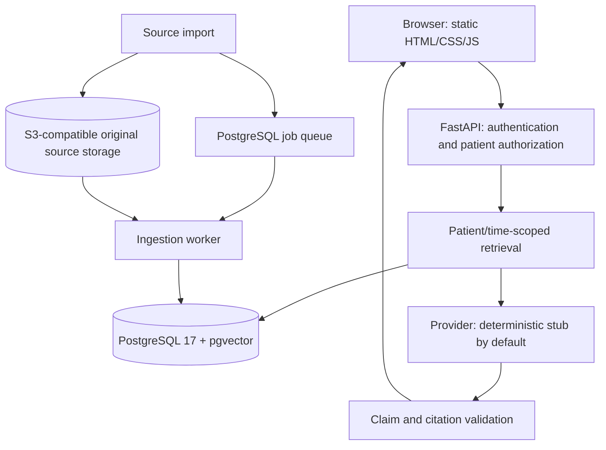

# Patient Memory: agent and collaborator context

Last updated: 2026-10-17. This describes the implemented prototype and the user's intent. Read `AGENTS.md` before changing code. Treat the original specification as a target, not proof of implementation; consult `docs/build-status.md`, migrations and runtime code when details differ.

## Idea and intended users

This is a 36-hour hackathon project intended to reduce friction between nurses and older patients, particularly during long-term-care shift handoffs. Important observations get scattered across notes, people and shifts. A new nurse should be able to understand what was documented, what changed, what remains uncertain and where each assertion came from.

The initial ambition included speaking to an agent about a symptom, reviewing a patient's history and noticing emerging health risks before an emergency. The PointClickCare "Catch It Early" track rewards usefulness, clarity, creativity, execution and meaningful AI; explaining why a signal is flagged is valuable. The user also cares about social impact and validation on real, freely accessible data without credentialing delays.

The implemented direction is patient memory and evidence-backed handoff. It may help make warning observations visible, but it currently does not estimate sepsis, deterioration or any other clinical risk. Do not present it as a clinically validated early-warning model. Previous discussions explored prediction datasets and models; none establishes validation of this application.

Example intended flow: a nurse opens a patient, reviews recent sleep, mobility and patient-reported observations, asks a question, and checks the original evidence. Missing documentation must not become a claim that a condition is absent.

## Current state and user preferences

- Backend PR #1 was merged: https://github.com/ruandee/patient-memory-backend/pull/1 (merge commit `28e2aa90e844aaef9ca37402f701177879694767`).
- The frontend is on `build/frontend-stub`, in draft PR #2: https://github.com/ruandee/patient-memory-backend/pull/2. At this document's creation, its implementation commits are `0f6759f` and refresh fix `fedef45`; frontend changes are not yet merged into main.
- The current walkthrough explicitly uses the existing deterministic stub provider, with no paid model calls.
- The user prefers a future Codex SDK integration using their existing Codex setup instead of a paid API integration. That adapter has NOT been implemented. Verify supported authentication and SDK behavior when implementing it; do not promise unlimited/free inference.
- Keep the provider experience simple: readable observations, understandable limitations and source evidence. Backend details should not overwhelm the nurse.
- The user asked whether NoSQL is possible. It is possible, but no migration was requested or decided. PostgreSQL remains the implementation.
- Voice input, EHR/PointClickCare integration, production login and a trained prediction model are not implemented.

## System layout



One Python repository contains the API, worker and provider adapters. FastAPI also serves the frontend at `/app/`; no separate Node build or frontend server is required. Docker Compose runs PostgreSQL and LocalStack S3. The API runs on the host at port 8000. The default database port is 55432 and local object-store port is 59000, both bound to loopback.

### Import and processing

1. Authenticate and authorize an importer for the patient.
2. Accept a versioned source and preserve original bytes in object storage. Metadata and the source payload also live in PostgreSQL.
3. Create an idempotent processing job. Workers claim jobs with leases and retries.
4. Extract searchable observations and exact supporting spans. Structured inputs preserve concepts and values; free-text notes remain conservative attributed assertions, not fully understood clinical facts.
5. Store search representations and relationships, publish the processed source and increment the patient's revision atomically.

The fixture loaders process their own imports. A running worker is needed for subsequent queued API imports; displaying the already-loaded demo does not require a continuously running worker.

### Retrieval and answering

1. Validate the bearer identity and patient assignment before retrieval.
2. Restrict sources by patient, tenant, visibility, event time and system knowledge time.
3. Retrieve observations using PostgreSQL full-text search and deterministic hash vectors. Summary retrieval follows a separate scoped-observation path. Current retrieval defaults to at most 12 observations with a 6,000-byte quote budget; coverage reports truncation.
4. Pass selected evidence to a provider. `ExtractiveGenerator` returns exact quotes and classifies sections/attribution. It is not an LLM.
5. Validate evidence IDs, exact source offsets and verbatim support before returning claims, citations, conflicts, unknowns and coverage metadata.
6. The frontend renders text safely and lets the nurse open the underlying evidence.

The current vectors are `vector(64)` hash bag-of-words representations (`hash64-v1`), not trained semantic embeddings. Search explicitly reports `hash_embedding_baseline` as degraded capability. Successful plumbing tests do not establish clinical relevance or completeness.

Provider options currently accepted by settings are `stub`, `compatible` and `ollama`. Optional HTTP-compatible and Ollama adapters exist; see their decision document and measured local trial. Current claim validation requires verbatim source support, so adding free-form generated prose would require an explicit contract/evaluation change rather than simply swapping a model.

## Context and time semantics

- `as_of`: clinical/event-time horizon. A historical observation should not silently become a current measurement.
- `known_at`: what had been ingested and published by that time. A late-entered note cannot appear in an earlier knowledge snapshot.
- `recorded_at`: when the source says it was recorded, separate from ingestion.
- Corrections create new source versions linked by `supersedes`. Earlier knowledge snapshots retain the earlier version; corrections do not rewrite history.
- Facts retain attribution, polarity, effective intervals and exact evidence. Unknown event time remains explicit.
- Structured conflicts may be surfaced. General semantic conflict resolution in free-text notes is not implemented.
- Cached answers depend on patient revision and request scope. A cached summary is not primary evidence for future summaries.

The demo selects January 2, 2026 as its fixture shift and uses current system knowledge. This makes amendments visible; it does not mean those observations occurred today.

## Actual database schema

There are 12 application tables, plus Alembic migration bookkeeping. UUIDs identify most entities. Patient-owned references use composite tenant/patient keys, and row-level security restricts runtime access using a non-owner database role.

| Table | Important fields / purpose |
| --- | --- |
| `tenants` | `id`, `name`: organization/workspace boundary |
| `principals` | `tenant_id`, `id`, `name`, `administrator`, `active`: users/service identities |
| `patients` | `tenant_id`, `id`, `external_id`, `revision`: minimal identity and memory version; not a demographics/EHR table |
| `assignments` | `tenant_id`, `patient_id`, `principal_id`, `role`, `active`; roles are importer, nurse or patient |
| `sources` | Versioned document key and external version, payload hash, object key, JSONB payload, canonical text, visibility, recorded/ingested/published times, supersedes/retraction/purge metadata |
| `facts` | Source reference, concept/value/unit/polarity/experiencer, event/order identifiers, valid interval, review status, quote and character offsets, vector(64), generated full-text search field |
| `relations` | Links two same-patient facts with supports, contradicts or supersedes |
| `jobs` | Source processing state/stage, attempt count, lease/token, retry time and error code |
| `operations` | Scoped idempotency key, payload hash and saved result to prevent duplicate writes |
| `answers` | Scoped cache key, principal, revision, JSONB response and expiry; default five minutes |
| `audit` | Actor, tenant/patient, action, result, request ID and timestamp; no note bodies/free-text questions |
| `request_budgets` | Per-tenant/principal request-window counters |

A fact is an extracted observation, not independently established clinical truth. Evidence is stored directly on facts; there is no separate EvidenceLink, Chunk or Embedding table in this implementation, despite broader entities appearing in the original architecture specification. Original bytes are in S3, while payload and canonical text also exist in PostgreSQL. There is no graph database or separate vector database.

PostgreSQL was chosen for transactional publication, foreign keys, access isolation and temporal joins. JSONB already accommodates variable source payloads. A document database is feasible but would require redesigning storage/retrieval and preserving these guarantees; changing databases alone does not simplify the clinical context problem.

## Frontend and API

The frontend uses `src/patient_memory/web/{index.html,style.css,app.js}`. It provides a patient directory, shift-date selector, handoff summary, question suggestions/input, source timeline and evidence dialog. Patient changes discard stale asynchronous results. Unsupported questions, service errors and limited coverage remain visible.

Main browser endpoints:

```text
POST /v1/patients/{id}/summaries
POST /v1/patients/{id}/questions
GET  /v1/patients/{id}/timeline
GET  /v1/patients/{id}/evidence/{id}
```

Each requires a bearer token. The browser directory comes from the local demo manifest rather than a patient-list endpoint. Full contracts are in `docs/openapi.json`; Swagger is `/docs`.

`scripts.frontend_demo` creates six fictional patients in a fresh tenant with nurse read access. It opens a URL containing an encoded session in its fragment. The browser removes the fragment and retains demo credentials in tab-scoped sessionStorage. Refresh preserves the session; Disconnect removes it. Tokens expire after eight hours. This is synthetic demo authentication, not a production login design. Do not commit or share generated session links/token files.

An earlier bug cleared login on refresh; `fedef45` fixed it. Opening bare `/app/` in a different tab/profile can still show the connect screen because session state is tab-scoped. Run the launcher to connect that browser. Opening a URL through the default browser does not guarantee Chrome; specify Chrome explicitly if requested. Headless browser test success does not prove a visible user window opened.

## Run locally

Prerequisites: uv, a supported Python version, Docker Desktop/Compose and Git. From the repository root:

```powershell
uv sync --frozen
docker compose up -d --wait db object-store
uv run alembic upgrade head
$env:PM_PROVIDER='stub'
uv run uvicorn patient_memory.api:app --host 127.0.0.1 --port 8000 --no-access-log
```

In a second terminal, from the same directory:

```powershell
$env:PM_PROVIDER='stub'
uv run python -m scripts.frontend_demo --open
```

The original developer checkout is nested at:

```text
C:\Users\deeru\Documents\antigravity\vibrant-oppenheimer\data\literature\patient-memory-backend
```

That path is machine-specific; another collaborator should use their clone root. The parent workspace contains unrelated research and is not this repository. Do not assume previously launched services survive between sessions. Liveness is `/v1/health/live`, not `/health`; `/v1/health/ready` requires authentication.

## Validation and limits

Recorded local results before this documentation change:

- Existing backend suite: 42 tests passed; two new frontend contract tests also passed, 44 in total across those runs. Includes real local PostgreSQL/S3 integration, API authentication, nurse access, foreign-patient denial and denied imports.
- Ruff and JavaScript syntax checks passed.
- Headless Chrome exercised summaries, six patients, source citations, unsupported-question abstention, timeline, patient switching, disconnect/reconnect, a deliberately simulated 503 and mobile overflow. Desktop/mobile screenshots were inspected.
- Refresh restoration and clearing credentials on Disconnect followed by refresh passed browser checks after the fix. Backend tests were not rerun for that browser-only change.
- The browser automation used local temporary tooling outside this repository; it is not a committed CI browser suite.
- Earlier offline regression: expected-source recall 48/48, abstention 12/12 and in-scope retrieval 60/60 on 60 authored synthetic questions. These are engineering regression results, not held-out clinical validation. See `docs/evaluation-results.md` for the preserved initial failure and limits.
- Paid-provider tests were not run for the frontend work. No real patient data or clinical prediction model is integrated.

Useful commands:

```powershell
uv run ruff check .
uv run pytest tests
node --check src/patient_memory/web/app.js
uv run python -m evals.run --suite synthetic --provider stub --output artifacts/eval.json
```

Do not claim exhaustive chart review, clinical accuracy, regulatory compliance or prevention of emergencies from these results. Production identity, real-data permissions/handling, clinical ownership and human review remain unresolved.

## Where to read next

| Location | Purpose |
| --- | --- |
| `AGENTS.md` | Required implementation and handoff rules |
| `docs/build-status.md` | Actual milestone status and remaining gates |
| `docs/01-product.md` through `docs/05-build-plan.md` | Original product, architecture, contracts, evaluation and build targets |
| `migrations/versions/001_initial.sql`, `002_lifecycle.sql` | Authoritative implemented schema and database policies |
| `src/patient_memory/api.py`, `auth.py`, `storage.py` | Routes, authentication and scoped database access |
| `ingestion.py`, `worker.py`, `extraction.py` in that package | Source processing and search representation |
| `retrieval.py`, `generation.py`, `providers.py` | Evidence retrieval, response validation and model adapters |
| `lifecycle.py`, `objects.py`, `pagination.py` | Retraction/purge, source objects and timeline pagination |
| `scripts/frontend_demo.py` | Nurse-scoped browser launcher |
| `docs/decisions/003-frontend-walkthrough.md` | Frontend scope and session choices |
| `docs/evaluation-results.md`, `docs/local-model-results.md` | Measured results and their limitations |

## Suggested next work, not yet implemented

1. Finish reviewing the frontend PR and refine the nurse workflow based on feedback.
2. Add the requested Codex SDK provider behind the existing interface, after verifying supported local authentication; preserve scoped evidence and output validation.
3. Improve retrieval/extraction and evaluate support and missed context on an appropriate untouched test set. Do not confuse evidence-selection success with risk-prediction performance.
4. Decide explicitly whether the hackathon submission remains a handoff/context tool or adds a separately evaluated early-risk component. The latter needs a defined outcome, dataset, time horizon and credible evaluation.

Do not silently expand this into autonomous diagnosis, treatment, production clinical deployment or a database migration. Explain the implemented system first, and distinguish proposed capabilities from working ones.
