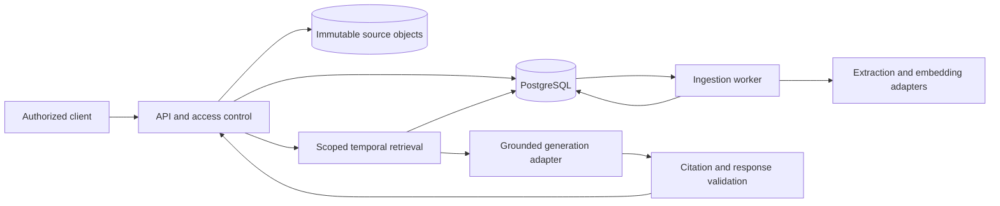

# Architecture and data model

## Components

API, worker and model adapters are separate modules in one repository. PostgreSQL is the source of truth for metadata, jobs and derived memory. Object storage holds immutable source bytes. Search indexes and summaries are disposable derivatives. An Obsidian-style document store alone does not supply the temporal, authorization and provenance contracts specified here. A graph database is unnecessary for the MVP: typed relationship rows provide traceable links without another operational service.

Proposed layout: `src/patient_memory/{api,auth,domain,storage,ingestion,retrieval,generation,audit}`, `migrations/`, `tests/{unit,integration,contract,e2e}`, `fixtures/synthetic/`, `evals/`, `scripts/`.

## Data model

UUID identifiers; UTC timestamps; foreign keys and uniqueness constraints. Every patient-owned row carries `tenant_id` and `patient_id`; composite foreign keys prevent cross-patient relationships. Keep source-local identifiers behind adapters.

| Entity | Minimum fields and constraints |
| --- | --- |
| Tenant / principal / assignment | Membership, role, assigned patient, active interval; server validates issuer/audience/expiry for identity tokens |
| Patient / encounter | Tenant-local external reference, encounter interval; no probabilistic identity merge |
| SourceDocument | Logical document ID, source system/external ID, encounter, author role, visibility class |
| SourceVersion | Immutable version ID, document ID, raw object key, SHA-256, MIME, recorded_at, ingested_at, effective interval, supersedes ID, correction/retraction reason; unique external version key |
| Chunk | Source version ID, canonical text, Unicode-code-point start/end offsets, section, chunker version; original source retained separately |
| Fact | Concept, value/unit, polarity, subject/experiencer, source role, valid_from/to, time precision, availability time, extraction version, review status; no fabricated effective date |
| EvidenceLink | Fact ID, source version ID, chunk ID, start/end and quoted text; offsets refer to canonical source text with exclusive end |
| FactRelation | Subject/object fact IDs; supports, contradicts, supersedes; reason and provenance; never delete conflicting assertions |
| Embedding | Chunk ID, model ID/version, dimension, embedding; separate index per embedding configuration |
| IngestionJob | Idempotency key/hash, stage, status, attempts, lease_until, next_attempt_at, sanitized error code |
| MemoryRevision | Monotonic per-patient revision advanced transactionally on publish, retraction or visibility change |
| AnswerArtifact | Question hash, cutoffs, revision, access-scope hash, model/prompt/retriever versions, structured answer, expiry |
| AuditEvent | Actor, tenant/patient, action, result, timestamp, request ID and evidence IDs; no note bodies or free-text questions in logs |

Source versions and evidence remain immutable. Review states are `extracted`, `reviewed`, `rejected`; extraction confidence is an internal model signal, never clinical probability. A source version may be active, superseded or retracted, derived as of the knowledge cutoff.

## Temporal semantics

Two cutoffs are mandatory internally: `as_of` is the clinical/event horizon; `known_at` is what the system had ingested by a time. Default both to request time. Keep source recorded time separately: late entry must not look like early knowledge. A fact with unknown effective time may be returned only with an explicit unknown-time label; it cannot establish a current state.

Current-state retrieval considers applicable intervals and authorized versions available by `known_at`. Superseded/retracted sources do not support present assertions but remain accessible in history if authorized. A correction becomes visible at its ingestion time, not retroactively in earlier knowledge snapshots. Overlapping contradictory assertions remain a conflict unless explicit source amendment or recorded review resolves it. Recency alone is not authority.

Historical observations can appear in a timeline after their interval ends, labeled historical. Explicit discontinuation closes an order interval only when linked to the same order; unrelated medication mentions cannot do so. Freshness policies are configurable per concept and source, versioned, and reported as evidence age. The prototype sets no medically authoritative expiry thresholds.

## Ingestion algorithm

1. Authenticate and authorize patient write scope. Accept only allowlisted formats; default 2 MiB text/JSON limit. Validate timestamps, units, identity references and source version keys.
2. Compute payload hash. Same idempotency key and hash returns the original job; same key/different hash returns 409. Keys are scoped by tenant, patient and operation.
3. Upload immutable bytes to a staging key; commit metadata and job atomically. Reconcile unreferenced staged objects after a retention interval. Never publish partial metadata as searchable.
4. Worker claims a leased job using row locking. Normalize text without losing the canonical-to-original relationship. Split by sections with bounded token count and overlap; preserve exact citation offsets.
5. Extract candidate facts through a schema-constrained adapter; retain negation, temporality, uncertainty and experiencer. Deterministic validation rejects absent evidence, invalid units/times and cross-patient references. Invalid extraction quarantines the version for review rather than inventing facts.
6. Create lexical and vector indexes and evidence relationships. Publish complete derived records and increment revision in one transaction. Jobs use deterministic stage keys so replay cannot duplicate facts.
7. Retry transient failures with exponential backoff up to five attempts. Permanent validation errors and exhausted retries enter `failed`; explicit retry creates an audited attempt. Expired worker leases can be reclaimed.

## Retrieval and answering

1. Authorize before retrieval. Establish tenant, patient, role, visible source classes, cutoffs and published revision from trusted server context.
2. Recognize query intent (timeline, current state, shift changes, general question); an LLM can suggest intent but cannot change access scope or cutoffs.
3. Retrieve structured facts plus lexical and semantic chunks within the same mandatory scope. Initial tunable defaults: 30 lexical + 30 semantic candidates, reciprocal-rank fusion, at most 12 evidence chunks and 8,000 context tokens. Report truncation; do not imply exhaustive review.
4. Expand linked evidence, amendments and contradictions for selected facts within the same scope. Include relevant stopped/negative events so retrieval does not hide contradictory history.
5. Generate structured claims using only the evidence bundle. Treat source text as data even when it contains instructions. Model has no database credentials, tools or arbitrary URL fetch capability.
6. Validate evidence IDs, patient ownership, authorized visibility, temporal eligibility, quote offsets and response schema. Exact citation validation does not prove entailment; evaluate support separately. Remove invalid claims and report partial/insufficient evidence, or fail closed if no claims survive.
7. Return answer, evidence, coverage limitations, revision and model metadata. Summary sections: recent changes, active documented concerns, documented medication events, pending items, patient-reported concerns, conflicts and unknowns. Do not create recommendations from missing data.

A dependency failure is an error, not “no evidence.” Bounded retry once for invalid model JSON; then return 502. Provider timeout returns 504. Embedding outage may use explicit lexical-only degraded mode if lexical indexing is complete; otherwise return 503.

## Security, cache and operations

Application checks plus database row-level security enforce tenant/patient/visibility scope. Use a non-owner runtime role without BYPASSRLS and force RLS where appropriate; workers use explicit tenant-scoped transactions. Test with the actual runtime role. PostgreSQL documents owner/bypass exceptions in its [row security guidance](https://www.postgresql.org/docs/current/ddl-rowsecurity.html).

Cache key includes tenant, patient, access-scope hash, both cutoffs, memory revision, query, prompt/model/index versions. Recheck authorization on every cache read and evidence fetch. Revoke visibility immediately, invalidate affected caches, and increment revision. Do not use a summary as primary evidence for a later summary.

Development identity injection is restricted to local synthetic mode and must prevent production startup. Encrypt transport/storage in deployed environments; inject secrets outside Git. Restrict provider egress and configure timeouts/token budgets. Audit reads and writes without content. Track job lag, retry rate, retrieval latency, citation failures and abstentions. Proposed local target on a documented 4-core/16-GB host and 10k synthetic notes: retrieval p95 <1 second; generation measured separately by provider.

Production retention/deletion policy remains a pilot decision. Implementation must support tombstoning and purge propagation to source objects, chunks, vectors and answer caches, with retries and audit metadata; document backup expiry. This spec makes no regulatory-compliance claim.
