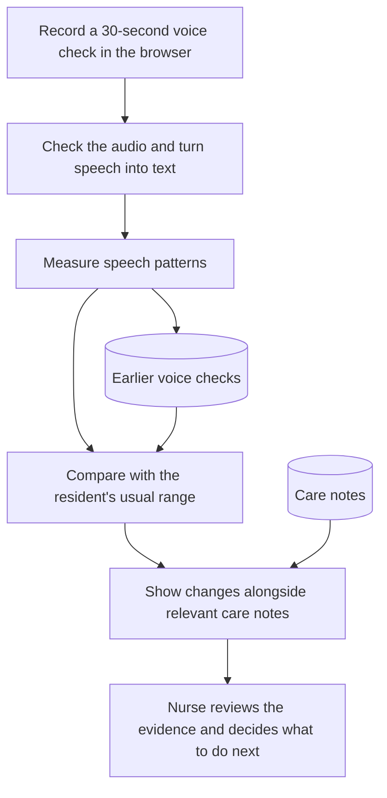

# Baseline - Devpost draft

Draft only. The project story below is ready to paste; the final section is for the team.

## Project name

Baseline

## Tagline

Help care teams notice when someone is different from their usual self.

## Inspiration

In older adults, an infection often shows up first as confusion, not fever. Fever may be absent in 20 to 30 percent of older adults with a serious infection, according to a [1996 review in *Infectious Disease Clinics of North America*](https://pubmed.ncbi.nlm.nih.gov/8698997/). When researchers [studied 817 older adults](https://repository.escholarship.umassmed.edu/entities/publication/bfe49db9-5f80-4016-86da-d1d24c655811) who came to U.S. emergency departments with COVID-19, 28 percent were delirious on arrival. More than a third of those had none of the usual signs, such as fever or shortness of breath, the 2020 study in *JAMA Network Open* found.

That confusion (delirium) is easy to miss. In a [2001 study in *Archives of Internal Medicine*](https://dash.harvard.edu/entities/publication/73120378-e168-6bd4-e053-0100007fdf3b), nurses recognized delirium in only 31 percent of the hospitalized older patients who had it. It is even harder to spot in people with dementia. A [2008 study of long-term care residents with dementia](https://pmc.ncbi.nlm.nih.gov/articles/PMC2277396) found that 71.5 percent had delirium, yet nurses detected it in just 13 percent of cases.

Care aides often notice that someone "seems off" days before anything reaches the chart. In one nursing-home study [published in the *Journal of the American Geriatrics Society*](https://pubmed.ncbi.nlm.nih.gov/10983908/), aides documented signs of illness an average of five days before the chart did. But "seems off" is not something a system can track. On a night shift one nurse may cover a whole unit: [Ontario's Auditor General found](https://www.auditor.on.ca/en/content/news/23_summaries/ag_AR_LTCresidential_en23.pdf) evening and overnight ratios as high as one nurse to 80 residents. And agency staff do not know what anyone's normal looks like. Their share of hours worked in Ontario long-term care nearly doubled in a single year, from 7.6 to 14.9 percent, according to [Ministry of Health figures obtained by The Canadian Press](https://www.cbc.ca/1.7154329).

PointClickCare's "Catch It Early" challenge asked for a way to catch a confused moment early and to explain *why* something was flagged. We built around that last part.

## What it does

Baseline turns a short voice check into a clearer picture of who may need attention. Care teams can see what changed, read relevant care notes, and prepare a handoff without searching through scattered records.

## How it works

A care aide opens a resident's check and records them counting and saying the days of the week during a 30-second recording window. Baseline checks the recording, turns speech into text, and measures patterns such as speaking speed and pauses. It compares those patterns with the resident's earlier checks to look for a change from their usual range.

The result reaches the nurse's overview, where residents needing attention are easier to find. Opening a resident shows the change over time alongside relevant notes and links to the original records. The nurse reviews that context and decides what to do next. The resident simply receives a thank-you, without a clinical score.

If a recording is unusable or there is too little history, Baseline says so. A change is a reason to look closer, not a diagnosis.

## Challenges and what we learned

The hardest part was making a change understandable. A number alone cannot explain someone's situation. We learned to keep the recording simple and put the history, supporting notes, and uncertainty together for the person reviewing it.

## What we're proud of

We connected recording, comparison, and review in one working prototype, demonstrated with fictional residents.

## What's next

Test the experience with consenting volunteers and care professionals, especially on real phones. Baseline is a decision-support prototype; it has not been clinically validated.

## How we built it

The app runs on Google Cloud. If the audio is unusable or there is too little history, it asks for another check or shows that more information is needed.

Built with Python, FastAPI, PostgreSQL, TimescaleDB, FFmpeg, Whisper, HTML, CSS, JavaScript, Docker, and Caddy.

---

## Team only — do not paste this section into the project story

### Built with

Python, FastAPI, Pydantic, PostgreSQL, TimescaleDB, FFmpeg, faster-whisper, WebRTC VAD,
Praat/parselmouth, HTML, CSS, JavaScript, Docker, Caddy, Google Cloud Compute Engine.

Add Gemini API to the final technology/prize fields only with the team's explanation of its
actual configured use. The hosted release currently uses `PM_PROVIDER=stub`. LocalStack
provides S3-compatible source storage in the demo; do not describe it as a production AWS deployment.

### Links and submission fields

- Code: https://github.com/ruandee/patient-memory-backend — currently private; a repo admin must
  decide on publication after the history/secret review. Do not change visibility as part of this draft.
- Demo: https://baseline.deeruan.com/unit — verified on release
  `f7f02c0a77d60b29efceb32c61b11cd96d74d193` (the same application tree as main
  `250cd51fbb56f1a7d9206439b2cc80be2f55d09f`), per the current deployment handoff.
  Historical scenario snapshots are separate from actual live measurements.
  Recheck immediately before submission; the original VM is scheduled to stop October 18 at
  about 9:09 PM Toronto time. Newer merged features are not automatically deployed.
- Video: add the actual uploaded video URL and verify access from a signed-out browser.
- Team: confirm names, contributions and Devpost accounts with the actual participants.
- AI development tools: Claude Code and OpenAI Codex; confirm the team's complete disclosure.

### Prize claims to confirm

- PointClickCare / healthcare / social impact: frame as an explainable prototype; do not claim
  a vendor partnership, real patient deployment, clinical accuracy or measured health outcomes.
- Gemini: prior connectivity smoke tests do not establish live note or handoff quality. Confirm
  the actual demonstration and official track requirements before selecting the prize.
- Tiger Data: describe the actual TimescaleDB/time-series use. Do not call `voice_checks` a
  hypertable; the implementation uses an ordinary table to preserve its access controls.
- KAZE: describe the extension as a prototype unless the real two-phone text-and-acknowledgement
  loop has been demonstrated. Logged delivery is not a sent text.
- Hosting is Google Cloud; the domain is managed through Namecheap. Do not claim Vultr or GoDaddy use.

### Final editing checks

- Keep the three fictional cases and a screenshot of the actual nurse screen.
- Remove any sentence describing a feature that cannot be shown in the final demo.
- Replace the fallback-provider sentence only after verifying the configured live model.
- The accepted live plan uses Dee instead of the remote runner (decision 030). Claim that
  segment only after successful same-person rested enrollment and rehearsal; an actual live
  result may be normal. The separate three-day local demo has authored results, not measurements
  computed from its recording (decision 034). Neither proves exertion or clinical detection.
- Audio is deleted after processing unless a developer retention flag is enabled. Measurements,
  transcript and word timings remain with the check; confirm consent and data handling before
  recording a real person.
- Public submission, prize selection, repository visibility, video publication and real-person
  recording remain separate human actions. This document does not complete #24 or #25.
